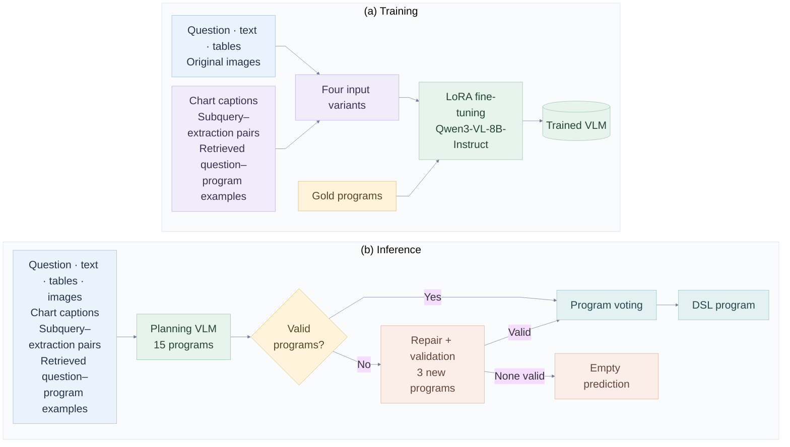

# A Multi-Stage Framework for Numerical Reasoning in Financial Question Answering

A multimodal, program-based framework for the VLSP 2026 financial numerical reasoning shared task. Given a financial question and supporting text, tables, and images, the system generates a program in the task's domain-specific language (DSL).

The framework combines chart transcription, question decomposition and evidence extraction, hybrid retrieval, LoRA fine-tuning, and program-level voting.

> **Repository data:** The checked-in datasets, images, captions, evidence, and augmented examples are illustrative samples. Replace them with the corresponding shared-task data and artifacts to reproduce an experiment. Trained adapter weights are not included; train an adapter or place trained weights in `models/lora/`.

## Methodology

### Task formulation and framework overview

Given a question $q$ and a financial context $C=(T,B,I)$, where $T$, $B$, and $I$ denote text, tables, and images, respectively, the task is to predict a DSL program $p$. The program specifies numerical operations, their arguments, and references to intermediate results. This formulation follows the program-based output required by the shared task.

Our framework prepares supporting information before program generation. Chart transcription converts visible chart content into structured text. Question decomposition and extraction construct intermediate evidence, while a hybrid retriever selects related question–program examples from the training set. The program generator receives these inputs together with the original multimodal context.

Training and inference use this information differently. During training, we construct four input variants and fine-tune the generator against the original gold programs. During inference, the trained model generates multiple candidates, which are checked and grouped for program-level voting. Captions and intermediate evidence are generated in advance and reused; the planning stage does not require loading the decomposition model.

### Framework diagram



**Figure 1.** Overview of training and inference. Chart captions and intermediate evidence are precomputed and cached for both stages. Four input variants preserve the gold program for LoRA fine-tuning of the planning VLM. At inference, the planning VLM combines the original multimodal context with cached captions, intermediate evidence, and retrieved examples. Validation and program-level voting select the output, with one repair round when no initial candidate is valid.

### Supporting information

- **Chart transcription (`caption.py`):** `Qwen/Qwen3.5-4B` transcribes visible chart titles, legends, axes, units, and printed data labels. The prompt preserves Vietnamese text and forbids estimating values from graphical positions. Downstream stages consume the cached `raw_output` text.
- **Decomposition and extraction (`extract_evidence.py`):** `Qwen/Qwen3-8B` produces subqueries and extracts supporting information using text, tables, and cached chart captions. Subquery–extraction pairs are saved by question ID and reused during training-data construction and inference.
- **Hybrid retrieval (`common/hybrid_retriever.py`):** BM25 and dense similarities from `BAAI/bge-m3` are combined using reciprocal rank fusion. The pipeline retrieves 10 candidates and retains up to 5 question–program examples after filtering self examples, duplicate questions, and programs that cannot be converted to the planner format.

Intermediate evidence is auxiliary: the planning prompt instructs the model to check it against the original question and context because it may contain errors. Original images remain part of the planning VLM input.

### Four training input variants

`augment.py` constructs the following variants for each training question:

| Variant | Input construction |
| --- | --- |
| `base` | Original context with chart captions, subquery–extraction pairs, and retrieved examples. |
| `swapped` | Permutes media blocks, subquery–extraction pairs, and retrieved examples, and varies context layout. |
| `decompose` | Uses the shuffled input with subqueries as information-seeking hints, removing their extracted answers. |
| `no_subquery` | Uses the shuffled input with the subquery–extraction section removed. |

`train.py` joins each variant with the original sample by question ID, restores original images using their `Image N` markers, and derives supervision from the original gold program. All variants retain the same gold target, converted to the planner format. Loss is applied only to the assistant's gold-program tokens.

### Candidate validation, voting, and repair

The default inference configuration samples **15 candidate programs**. Candidates must be complete, follow the numbered planner syntax, use supported operators and arguments, contain valid references to earlier results, and refer to available table and image IDs.

Valid candidates are grouped by program structure. Arguments of `add` and `multiply` are sorted for grouping; voting does not execute programs or group them by numerical answers. The largest group wins. Ties prefer fewer steps, then the earliest candidate.

If all initial candidates are invalid, the model receives representative validation errors and generates **3 new candidates in one repair round**. The same validation and voting rules apply. If repair yields no valid candidate, the output program is an empty string.

## Repository structure

```text
.
├── caption.py                 # Chart transcription and caption caching
├── extract_evidence.py        # Question decomposition and evidence extraction
├── augment.py                 # Four gold-preserving input variants
├── train.py                   # Multimodal LoRA fine-tuning
├── infer.py                   # Generation, validation, voting, and export
├── requirements.txt
├── common/
│   ├── hybrid_retriever.py    # BM25 + dense retrieval with rank fusion
│   ├── prompt_contract.py     # Shared prompt construction and example filtering
│   ├── multimodal_dataset.py  # QID joins, image binding, and dataset preparation
│   ├── program_format.py      # Planner parsing and DSL conversion
│   ├── planning.py            # Candidate selection and strict program matching
│   ├── inference_engine.py    # PEFT inference, repair, resume, and exports
│   ├── pipeline.py            # Shared decomposition, extraction, and program utilities
│   └── financial_tools.py     # Financial operation utilities
├── data/
│   ├── train.json
│   ├── public_test.json
│   ├── private_test.json
│   ├── train_images/
│   ├── public_test_images/
│   ├── private_test_images/
│   ├── caption/               # <data_stem>_caption.jsonl
│   ├── decompose_extraction_evidence/  # dec_ex_<split>.jsonl
│   └── augment/               # base, swapped, decompose, no_subquery JSONL
├── models/lora/               # Trained adapter and processor (generated or supplied)
└── outputs/                   # Caches, checkpoints, traces, and predictions
```

## Installation

The dependency file targets **Linux x86_64, Python 3.12, and an NVIDIA CUDA GPU**. Training uses Unsloth; caption generation uses vLLM; planning inference uses Transformers and PEFT. The default training and planning configurations use BF16. GPU memory requirements depend on context length, image resolution, and candidate batch size.

```bash
git clone https://github.com/phucmap85/vlsp2026-financial-numerical-reasoning.git
cd vlsp2026-financial-numerical-reasoning

conda create -n vlsp2026 -c conda-forge python=3.12 pip -y
conda activate vlsp2026
python -m pip install -r requirements.txt
python -m pip check

nvidia-smi
python -c "import torch; print(torch.__version__, torch.version.cuda, torch.cuda.is_available())"
```

Model identifiers are configured in the scripts. Downloads require access to the corresponding Hugging Face models; the settings can also point to local model directories.

## Data and cached artifacts

Each dataset JSON contains a list of records (a `root` wrapper is also supported by the shared readers). A record includes `qid`, `text`, `tables`, `images`, and `qa.question`. Training records additionally require `qa.program`.

```json
{
  "qid": "sample-001",
  "text": ["Financial context...", "### Table 1 ###", "### Image 1 ###"],
  "tables": {"Table 1": "<table>...</table>"},
  "images": {"Image 1": "chart.png"},
  "qa": {
    "question": "What is the increase from 2022 to 2023?",
    "program": "subtract(120.0; 100.0)"
  }
}
```

Place referenced images in the corresponding image directory. Preserve question IDs, image filenames, and `Table N` / `Image N` source labels across raw data and caches.

| Split | Dataset | Image directory | Caption cache | Evidence cache |
| --- | --- | --- | --- | --- |
| `train` | `data/train.json` | `data/train_images/` | `data/caption/train_caption.jsonl` | `data/decompose_extraction_evidence/dec_ex_train.jsonl` |
| `public` | `data/public_test.json` | `data/public_test_images/` | `data/caption/public_test_caption.jsonl` | `data/decompose_extraction_evidence/dec_ex_public.jsonl` |
| `private` | `data/private_test.json` | `data/private_test_images/` | `data/caption/private_test_caption.jsonl` | `data/decompose_extraction_evidence/dec_ex_private.jsonl` |

Caption records contain `image_file` and nonempty `raw_output` fields. Evidence records contain `id`, `subqueries`, and an aligned `extractions` list with `query`, `answer`, and `status` fields. Training data remains necessary during test inference because it supplies the retrieval corpus.

## Run inference with a trained adapter

1. Prepare the target split's dataset, images, captions, and evidence, together with `data/train.json` for retrieval.
2. Place the trained adapter in `models/lora/`, including `adapter_config.json` and `adapter_model.safetensors` (or the corresponding supported adapter weights). Keep saved processor files when available.
3. Set `SPLIT = 'public'` or `SPLIT = 'private'` in `infer.py`, then run:

```bash
python infer.py
```

The default is `SPLIT = 'private'` with `FLOW = 'vl_full'`. Entry-point settings are Python constants and dictionaries in the scripts; these commands do not expose CLI flags for selecting a split or changing hyperparameters.

### Inference defaults

| Setting | Default |
| --- | --- |
| Planning base model | `Qwen/Qwen3-VL-8B-Instruct` |
| Adapter | `models/lora/` |
| Retrieval model | `BAAI/bge-m3` |
| Initial candidates / repair candidates | 15 / 3 |
| Candidate batch size | 3 |
| Temperature / top-p / top-k | 0.7 / 0.8 / 20 |
| Maximum new tokens per candidate | 16,384, bounded by remaining context |
| Total context budget | 40,960 tokens |
| Image pixel bounds | 256 × 256 to 1024 × 1024 |
| Dtype / seed | BF16 / 0 |
| Shards | 1 (`SHARD_ID = 0`) |

### Outputs and program format

For the default private split and shard, outputs are written to `outputs/qwen3_vl_infer_private/shard_00/`:

| File | Contents |
| --- | --- |
| `results.json` | Exported records with `qid` and `program`. |
| `predictions.json` | Records with `qid`, `predicted`, and `status`. |
| `trace.jsonl`, `trace.json` | Inputs, candidates, validation errors, votes, and selected programs. |
| `prepared_inputs.jsonl` | Prepared multimodal prompts, evidence, and retrieval audit. |
| `metrics.json` | Completion/error counts and optional strict program accuracy. |
| `run_manifest.json` | Configuration, adapter hashes, input hash, and run fingerprint. |

`infer.py` also creates `outputs/qwen3_vl_infer_private/shard_00.zip` containing the main exported artifacts.

Internally, the planner uses numbered calls with named arguments, `$id` result references, a final `join()`, and `<END_OF_PLAN>`:

```text
1. subtract(a="120.0", b="100.0")
2. divide(a="$1", b="100.0")
3. join()
<END_OF_PLAN>
```

The exported DSL uses positional arguments separated by semicolons and zero-based `#index` references:

```json
[
  {
    "qid": "sample-001",
    "program": "subtract(120.0; 100.0); divide(#0; 100.0)"
  }
]
```

When gold programs are present, `strict_PA` reports exact program matching after whitespace removal only. It does not equate different numeric spellings or measure execution accuracy. For unlabeled data, this metric is `null`. Candidate validity reflects format and source-reference checks, not a guarantee of a correct financial answer.

## Reproduce the full pipeline

### 1. Generate chart captions

Set `SPLIT` in `caption.py` to the desired split (`train`, `public`, or `private`) and run once per required split:

```bash
python caption.py
```

The default split is `private`. Captions are appended to `data/caption/<data_stem>_caption.jsonl`, where `<data_stem>` is `train`, `public_test`, or `private_test`. Diagnostic CSV and Parquet files are saved in `outputs/caption/<split>/`.

### 2. Generate decomposition and extraction evidence

After captions are available, set the matching `SPLIT` in `extract_evidence.py` and run:

```bash
python extract_evidence.py
```

The default split is `public`. Shard results are written to `outputs/dec_ex_<split>/shard_00/dec_ex_<split>.jsonl`. Once all question IDs are covered, the script merges shards into `data/decompose_extraction_evidence/dec_ex_<split>.jsonl`. Configure `SHARD_ID` and `N_SHARDS` for a partitioned run.

### 3. Build the four training variants

With the training captions and evidence in place:

```bash
python augment.py
```

This writes `base.jsonl`, `swapped.jsonl`, `decompose.jsonl`, and `no_subquery.jsonl` under `data/augment/`. Retrieval embeddings are cached in `outputs/build_base_cache/`.

### 4. Fine-tune the planning VLM

```bash
python train.py
```

| Training setting | Default |
| --- | --- |
| Base model | `Qwen/Qwen3-VL-8B-Instruct` |
| Adaptation | LoRA; 4-bit QLoRA disabled |
| LoRA rank / alpha / dropout | 16 / 32 / 0.05 |
| Adapted components | Vision and language layers, attention and MLP modules |
| Epochs | 3 |
| Per-device batch size / gradient accumulation | 1 / 16 |
| Learning rate | `2e-5` |
| Scheduler / warmup ratio | Cosine / 0.05 |
| Maximum sequence length | 32,768 tokens |
| Dtype / seed | BF16 / 42 |
| Validation question IDs | 0 (no held-out validation by default) |
| Checkpoint interval | 50 steps |

Checkpoints, data checks, experiment settings, and loss history are saved under `outputs/qwen3_vl_sft/`. The final adapter and processor are saved to `models/lora/`. If validation is enabled with `VALIDATION_QIDS`, all variants of a question are assigned to the same partition.

### 5. Run program generation

Prepare the target test split's captions and evidence, select that split in `infer.py`, and run `python infer.py` as described above. This stage loads the planning VLM and adapter after retrieval preparation; it reuses cached evidence without loading the decomposition model.

## Reproducibility and troubleshooting

- **Missing images, captions, or evidence:** Check split-specific paths, question IDs, image basenames, and cache coverage. Training and inference validate joins rather than silently substituting missing support.
- **GPU memory or sequence-length errors:** Reduce `VL_CANDIDATE_BATCH_SIZE` or image pixel bounds for inference. For training, adjust image bounds and sequence budgets in `train.py`; the collator checks full multimodal length and complete gold supervision. Record configuration changes when comparing runs.
- **Resume inference:** Rerun with the same configuration, adapter, and inputs to reuse saved trace records. Saved records include errors; use a fresh `OUTPUT_ROOT` to retry them or start a changed experiment. Changed fingerprints require a new output directory.
- **Resume training:** `RESUME_FROM_CHECKPOINT = 'auto'` selects the latest checkpoint. If data or training settings change, use a fresh `OUTPUT_DIR`.
- **Regenerate caches:** Caption generation resumes from its Parquet records and appends raw captions to JSONL. When replacing data or caption settings, use fresh or deliberately reset caption artifacts together. Evidence generation overwrites the selected shard's file at startup; the merged evidence cache is replaced only after full coverage is available.
- **Change the retrieval corpus:** Use a fresh embedding cache or output directory so cached embeddings match the new training questions.

The checked-in examples demonstrate file formats and pipeline wiring. This README does not report benchmark results or a verified hardware memory requirement.
